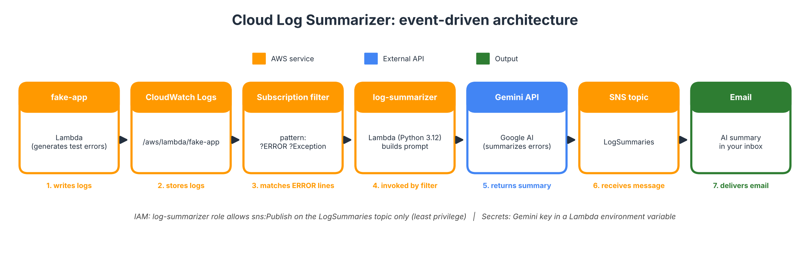
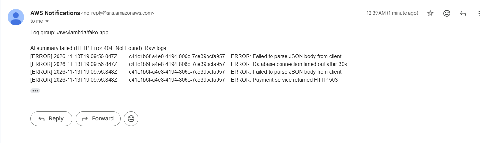
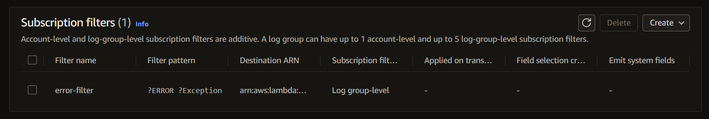
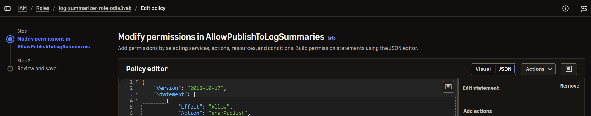
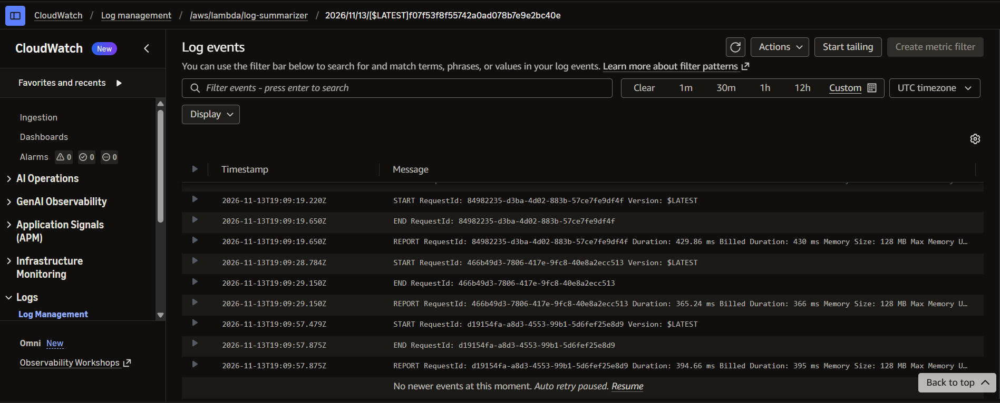

# Cloud Log Summarizer

An AWS pipeline that watches application logs and emails me a short plain-English summary whenever errors appear. Instead of scrolling through raw CloudWatch lines, I get a message that says what went wrong, the likely cause, and one suggested fix.

## Why I built it

My earlier AWS projects were scheduled or request-driven. I wanted one that reacts to events instead, and I wanted to try calling an AI API from inside a Lambda function. Reading error logs is a good use for it, because the logs are repetitive and the useful part is a quick summary.

## How it works

1. `fake-app` is a small Lambda that writes one normal log line and two to four random ERROR lines each time it runs. It stands in for a real application.
2. Its logs go to CloudWatch Logs (`/aws/lambda/fake-app`).
3. A subscription filter with the pattern `?ERROR ?Exception` forwards only matching lines to the `log-summarizer` Lambda, so normal INFO lines are ignored.
4. `log-summarizer` decodes the batch (CloudWatch sends it base64-encoded and gzipped), builds a prompt, and calls the Gemini API.
5. The summary is published to an SNS topic (`LogSummaries`), which emails it to me.

If the Gemini call fails, the function emails the first part of the raw logs instead, so an API outage doesn't mean silent errors.

## AWS services and tools

- AWS Lambda (Python 3.12)
- Amazon CloudWatch Logs with a subscription filter
- Amazon SNS (email subscription)
- AWS IAM (inline policy, least privilege)
- Gemini API (free tier), called with the standard library's `urllib`, so there are no dependencies to package

## Sample output

## Setup

I built everything in the AWS Console in one region (us-east-1). Use the same region for every step.

1. **Gemini key.** Create an API key in Google AI Studio. Keep it out of the repo.
2. **SNS.** Create a Standard topic called `LogSummaries`, add an email subscription, and confirm it from the email AWS sends. Copy the topic ARN.
3. **fake-app.** Create a Lambda with Python 3.12, paste in `fake_app.py`, deploy it, and run one test so the log group exists.
4. **log-summarizer.** Create a second Lambda, paste in `summarizer.py`, and deploy it. Then:
   - Set the timeout to 30 seconds (the default 3 seconds is too short for an API call).
   - Add the environment variables `TOPIC_ARN`, `GEMINI_API_KEY`, and `GEMINI_MODEL`.
   - Add an inline IAM policy on its execution role that allows only `sns:Publish` on the topic ARN.
5. **Subscription filter.** On the `/aws/lambda/fake-app` log group, create a Lambda subscription filter pointing to `log-summarizer`, with the pattern `?ERROR ?Exception`.
6. **Test.** Run `fake-app` two or three times, wait a minute or two, and check your inbox (and spam).

Never attach the subscription filter to the summarizer's own log group. Its logs would trigger it again and loop.

## What went wrong along the way

The first test produced no email. The `log-summarizer` logs showed an `AuthorizationError` on the `sns.publish` call: the function's role had no permission to publish to SNS. The filter and the Lambda were working, and only the last step was blocked. I added an inline policy allowing `sns:Publish` on the `LogSummaries` topic only, ran the test again, and the email arrived.

Two smaller things that caught me out: the filter only forwards logs written after it exists, so I had to run `fake-app` again to trigger it, and Lambda retried the failed batches on its own, which is why the same request IDs showed up repeatedly in the logs.

## Limitations and next steps

- The Gemini key sits in a Lambda environment variable. That's fine for a demo, but a real deployment should read it from SSM Parameter Store or Secrets Manager.
- Every matching batch sends one email. A burst of errors would send many emails, so batching or rate limiting would be the next addition.
- Everything was created by hand in the console. I'd like to rewrite it as a SAM or Terraform template, the way I did for my backup project.

## Screenshots

| | |
|---|---|
| Subscription filter |  |
| IAM inline policy |  |
| Summarizer logs |  |

## Files

- `fake_app.py` generates the test errors
- `summarizer.py` decodes the logs, calls Gemini, and publishes to SNS
- `images/` holds the diagram and screenshots